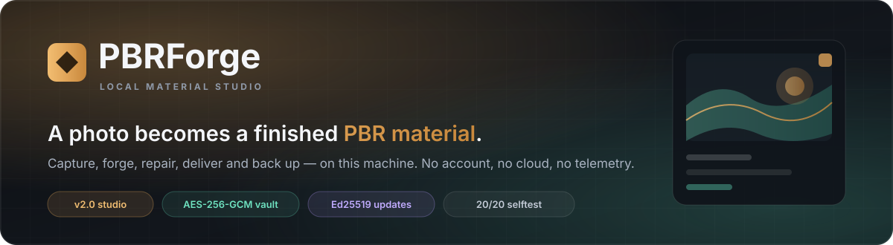

<p align="center">
  
</p>

<p align="center">
  <a href="https://github.com/learnerarchitecture-debug/pbrforge/releases/latest"></a>
  
  
  
  
</p>

<h1 align="center">Turn a photo into a PBR material.<br><span style="color:#E0A458">Keep the whole studio on your own PC.</span></h1>

<p align="center">
  <b>PBRForge 2.0</b> is a local-first material studio for one person: capture a bracketed photo set,
  generate a tileable surface, build a non-destructive material project, repair a texture set,
  deliver it to a DCC, and keep the library encrypted when you are done.
  <br><br>
  No account. No cloud. No telemetry. No uploads leave this machine.
</p>

<p align="center">
  <a href="#-quick-start">Quick start</a> ·
  <a href="#-whats-new-in-20">What is new</a> ·
  <a href="#-feature-status">Feature status</a> ·
  <a href="#-security-plainly">Security</a> ·
  <a href="#-cli">CLI</a> ·
  <a href="#-docs">Docs</a>
</p>

---

## ✦ Quick start

### Windows installer

Download **[`PBRForge-Setup-2.0.0.exe`](https://github.com/learnerarchitecture-debug/pbrforge/releases/latest)**,
run it, and open **PBRForge** from the Start Menu. It installs per-user in
`%LOCALAPPDATA%\Programs\PBRForge`; Administrator is not required.

The installer is **not Authenticode-signed**, so SmartScreen may ask for one explicit
**Run anyway** click. The release installer *is* covered by an Ed25519 signature for the built-in
updater; that is a different mechanism from Windows code signing and is described below.

### Source checkout

```powershell
git clone https://github.com/learnerarchitecture-debug/pbrforge.git
cd pbrforge
py -3.12 -m pip install cryptography
py -3.12 -m pbrforge selftest -v
py -3.12 -m pbrforge serve
```

Open the printed URL. On the same machine the default is `http://127.0.0.1:7788`. The server prints a
pairing code; enter it once on each device you want to use. The only runtime dependency is
`cryptography` (vault, Ed25519 verification and local TLS). The PNG codec, imaging pipeline, server
and CLI are standard-library Python.

> **Using a second PC?** Run `pbrforge tls init` and `pbrforge tls trust` first. Browsers only grant
> secure-context APIs on HTTPS or localhost; plain HTTP on a LAN is deliberately allowed but loses
> those APIs. See [DEPLOYMENT.md](DEPLOYMENT.md).

---

## ✦ What is new in 2.0

PBRForge 2.0 keeps the 0.2 Auto Forge path intact and adds a **Studio Lab** behind progressive
disclosure. The simple front door stays simple; the deeper controls are there when you need them.

| | Feature | What it actually does |
|---|---|---|
| 📸 | **Capture stacks** | Merge 2–12 PNG frames with exposure normalisation and median, mean, min or max. Makes a cleaner source for the normal pipeline. No geometric alignment. |
| 🧱 | **Surface Lab** | Generate tileable brick, tile, plank, panel, stone or noise surfaces with weathering and seed control. Preview locally; Forge sends the albedo through the normal pipeline. |
| 🎛️ | **Material projects** | An ordered, non-destructive stack of `offset`, `surface`, `weather` and `grade` layers. Re-render without overwriting the source. Not a general node graph. |
| 🩺 | **Set Doctor** | Scan a PBR texture set, identify map roles, flip normal Y, invert gloss/metal inputs, repack ORM/MRA, and write canonical names into a **new** folder. |
| 🚚 | **Delivery** | Write MaterialX (`.mtlx`), glTF 2.0 (`.gltf` + textures), USD (`.usda`) and a Blender material script. Textures are copied, not re-encoded. |
| 🏷️ | **Library metadata** | Tags, favourites, notes and physical tile size. Texel density is derived from real written pixels. Metadata lives in a sidecar `meta.json`; provenance stays untouched. |
| 👁️ | **Batch and watch** | Convert folders serially, or watch a folder with polling and a SHA-256 state file. New PNGs are forged through the same worker. |
| 🧩 | **Plugins** | Explicit local Python plugins with a manifest and a small API. List and run from the CLI. There is no marketplace, no auto-discovery and **no sandbox**. |
| 🔐 | **Encrypted vault** | Chunked AES-256-GCM backups with scrypt (`n=32768`, `r=8`, `p=1`), authenticated headers and chunks. Restore into a new folder. No cloud key escrow. |
| 🛡️ | **Harder server** | CSRF double-submit tokens, strict session cookies, Host allowlisting, same-origin write checks, rate limiting and security headers. |
| ✍️ | **Signed updates** | Release installers are verified with Ed25519. For v2.0+ auto-install, a valid release signature is required, not optional. |

---

## ✦ Feature status

Honest labels matter more than a long feature list.

| Area | State | Notes and limits |
|---|---|---|
| Auto Forge photo → PBR | ✅ shipped | 15 stages, nine presets, WebGL lit preview, QC report, zip export. Presets whose host application has not been exercised are labelled **unverified**. |
| Capture stacks | ✅ shipped | PNG only; 2–12 frames; exposure normalisation; median/mean/min/max. No tripod alignment or handheld registration. |
| Surface Lab | ✅ shipped | Six procedural patterns and five weathering modes. Server Forge runs the standard pipeline; direct map writing is a CLI/preview convenience. |
| Material projects | ✅ shipped | Ordered layer stack; source is copied into the project; re-render is non-destructive. No masks, nodes, painting or keyframes. |
| Set Doctor | ✅ shipped | Filename-role heuristics, safe copy, normal flip, gloss/metal inversion, ORM/MRA repack, canonical rename. It does not magically know an arbitrary file's role. |
| DCC / interchange | ✅ shipped | MaterialX, glTF 2.0, USD and Blender writers. Vendor import behaviour is not certified in every application; the files are portable text plus copied PNGs. |
| Library + calibration | ✅ shipped | Tags, favourites, notes, physical size, derived texel density, filters. Uses `meta.json`, not a database. |
| Batch and watch | ✅ shipped | Serial batch; polling watch loop with a SHA-256 state file. No OS filesystem notifications, no cloud queue. |
| Plugins | ✅ shipped | Local code execution when you explicitly run a plugin. Path-contained, manifest-checked, **not sandboxed**. |
| Encrypted vault | ✅ shipped | `.pbrvault`, chunked AES-256-GCM, scrypt KDF, authenticated metadata. Passphrase is never stored; lost passphrase means lost vault. |
| Signed releases | ✅ shipped | Ed25519 signature over the exact installer bytes. v2.0+ auto-install refuses an unsigned or mismatched release. |
| 3D / calibration | ◐ limited | WebGL viewer, physical tile size and texel-density metadata. **No model import, UV calibration, baking or renderer certification.** |
| EXR / float IO | ⏸ deferred | Not implemented. Input is PNG; exports are PNG plus 16-bit TIFF where a preset names it. An EXR request is refused with a named reason. |
| Local AI | ⏸ deferred | Not implemented. No model download, inference runtime or prompt-to-texture feature. |
| Cloud sync / accounts | ⛔ out of scope | Deliberately absent. Personal, local use only. |

---

## ✦ Two doors, one worker

<table>
<tr>
<td width="50%" valign="top">

### Auto Forge
Drop a photo. Pick a preset. Forge.

- detects the repeat lattice;
- heals the wrap seam;
- removes low-frequency lighting;
- derives height, normal, AO, roughness and metalness;
- audits the result and packs the set for your renderer.

This is the front door and it remains a single upload.

</td>
<td width="50%" valign="top">

### Studio Lab
Open only when you want the deeper controls.

- **Capture** — merge a bracket;
- **Surface Lab** — start from a procedural source;
- **Projects** — edit an ordered layer stack;
- **Set Doctor** — repair someone else's map set;
- **Delivery** — write DCC interchange files;
- **Vault & audit** — encrypt the library and inspect the local security posture.

</td>
</tr>
</table>

---

## ✦ Security, plainly

PBRForge is a personal local tool, not a multi-user service. The security design is proportioned to
that threat model.

| Control | Implementation |
|---|---|
| **Vault encryption** | AES-256-GCM, 1 MiB authenticated chunks, authenticated header. scrypt `n=32768`, `r=8`, `p=1`, random per-vault salt. No cipher fallback. |
| **Vault truth** | The passphrase is not stored. There is no recovery key, no cloud escrow and no “reset”. A forgotten passphrase means the vault is lost. |
| **Release integrity** | Ed25519 signature over the installer. SHA-256 and byte-size checks run first; the signature is mandatory for v2.0+ auto-install. |
| **Pairing** | One code, HMAC-signed stateless session cookie, `HttpOnly`, `SameSite=Strict`, `Max-Age`; `Secure` when TLS is on. |
| **Writes** | Session-bound CSRF token from `/api/session`, plus same-origin checks where an Origin is present. Host allowlisting blocks DNS-rebinding. |
| **Limits** | Per-client pairing/write rate limits, upload caps, path-containment checks and a fixed MIME allowlist. |
| **CSP** | `frame-ancestors 'none'`, `object-src 'none'`, `base-uri 'none'`, no external assets. The single-file UI requires inline scripts/styles, so `'unsafe-inline'` is an explicit trade-off. |
| **TLS** | Optional local CA and leaf certificate for LAN clients. HTTP remains available and is honestly reported as less capable. |

**What this does not protect against:** malware or a keylogger on the machine, someone who already
has your unlocked session, or arbitrary code you choose to run as a plugin. Plugins run with your
user rights and are not sandboxed. The vault protects data at rest, not a compromised desktop.

The installer is not Authenticode-signed. Release signatures are for the updater, not a replacement
for SmartScreen reputation.

---

## ✦ CLI

```powershell
python -m pbrforge serve                  # start the local studio
python -m pbrforge make photo.png         # Auto Forge one PNG
python -m pbrforge batch .\photos         # forge a folder serially
python -m pbrforge library                # list the local library
python -m pbrforge capture a.png b.png    # merge a bracket
python -m pbrforge surface --pattern brick --out maps
python -m pbrforge project create source.png --name "Wall"
python -m pbrforge setdoctor .\maps --out .\fixed
python -m pbrforge deliver .\maps --out .\delivery
python -m pbrforge watch .\inbox --once
python -m pbrforge plugin list
python -m pbrforge vault --help
python -m pbrforge security
python -m pbrforge release verify FILE --signature FILE.sig
python -m pbrforge selftest -v
```

Every command accepts `--json` where it makes sense. `--config-dir`, `--library` and `--cache`
override the resolved paths for isolated tests and portable runs.

The full command and flag reference is in **[docs/CLI.md](docs/CLI.md)**.

---

## ✦ Install and upgrade

| Route | Requirements | Notes |
|---|---|---|
| **Windows installer** | Windows 10/11, no Python | Per-user install, Start Menu shortcuts, optional logon task, optional local TLS certificate. |
| **Source** | Python 3.11+ and `cryptography` | Cross-platform source route; installer features such as shortcuts are Windows-only. |
| **Run from a checkout** | Same as source | `python -m pbrforge serve`; no build step required. |

Config and library live **outside** the install directory, so upgrades and uninstalls do not silently
replace your work. The vault backup includes config and library; it deliberately excludes ephemeral
cache content.

Updates are checked only when you ask; there is no background poller. A v2.0+ auto-install requires a
valid Ed25519 signature. See **[docs/UPDATES.md](docs/UPDATES.md)**.

---

## ✦ Docs

| Document | What is inside |
|---|---|
| [docs/STUDIO.md](docs/STUDIO.md) | Capture, Surface Lab, projects, Set Doctor, delivery, library metadata and watch folders |
| [docs/SECURITY.md](docs/SECURITY.md) | Threat model, vault format, release signatures, server controls and honest limits |
| [docs/CLI.md](docs/CLI.md) | Every command, flag and JSON output shape |
| [docs/WEB_APP.md](docs/WEB_APP.md) | Browser workflow, pairing, APIs and troubleshooting |
| [docs/UPDATES.md](docs/UPDATES.md) | Release contract, signature verification and install path |
| [docs/ARCHITECTURE.md](docs/ARCHITECTURE.md) | Module map, pipeline stages and design decisions |
| [INSTALLATION.md](INSTALLATION.md) | Installer, source setup and uninstall |
| [DEPLOYMENT.md](DEPLOYMENT.md) | LAN, TLS, firewall and multi-PC operation |
| [CHANGELOG.md](CHANGELOG.md) | Release history |

---

## ✦ Scope and honest refusals

PBRForge 2.0 is deliberately finished at a boundary. These are **not** hidden or partially wired:

- **EXR / float image IO** — not implemented; PNG input, PNG/TIFF export, EXR refused with a reason.
- **Local AI** — not implemented; no model, no inference, no claim.
- **True 3D calibration** — no mesh import, UV solving, baking or texel-density painting on a model.
- **Plugin sandbox / marketplace** — plugins are trusted local code, run explicitly.
- **Cloud sync, accounts, collaboration, telemetry** — out of scope.
- **Vendor certification** — interchange files are portable and tested structurally; every DCC is not.

If a feature is not in the table above, assume it does not exist. `pbrforge selftest` is the contract
test, and the UI refuses unsupported operations with a named reason rather than inventing a fallback.

---

## ✦ Repository map

```text
pbrforge/
  core/             typed images, PNG codec, colour-space gate, cache, synthesis
  stages/           the 15 pipeline stages
  export/           renderer presets and writers
  server/           stdlib HTTP server, pairing auth, discovery
  capture.py        bracketed frame merge
  surface.py        procedural tileable surfaces
  project.py        ordered material projects
  setdoctor.py      texture-set scan and safe repair
  delivery.py       MaterialX / glTF / USD / Blender delivery
  library.py        sidecar metadata and filters
  watch.py          polling folder watcher
  plugins.py        explicit local plugin loader
  security.py       vault encryption, Ed25519, audit
  jobs.py           staging, worker, promotion and previews
  update.py         release check and signed installer path
  cli.py            all command-line commands
ui/prototype.html   the dependency-free studio UI
plugins/            example local plugins
deploy/             PyInstaller spec and build scripts
installer/          Inno Setup definition
docs/               studio, security, CLI and deployment guides
```

---

## ✦ Verification

Run from a source checkout:

```powershell
python -m pbrforge selftest -v
python -m compileall -q pbrforge
```

The current selftest covers **20 checks**, including vault tamper/truncation refusal, Ed25519
verification, CSRF/Origin/Host enforcement, the studio modules, TLS and the LAN socket. The packaged
installer is built from the same tree and is exercised separately before release; the changelog and
release notes record what was actually run on which machine.

---

<p align="center">
  <b>PBRForge</b> · one person, one PC, finished materials.<br>
  <sub>Personal-use licence. No account, no telemetry, no cloud.</sub>
</p>
